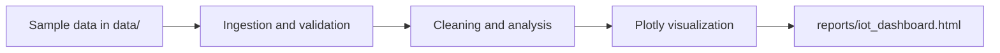

# Architecture

## Overview

The planned Python pipeline converts small IoT sensor datasets into an HTML dashboard.
This document describes the intended design; implementation is pending.

## Components

- `src/ingestion/`: Load sensor readings and validate required fields.
- `src/analysis/`: Clean readings, compute statistics, and identify anomalies.
- `src/visualization/`: Build Plotly charts and export the HTML dashboard.
- `data/`: Store small, non-sensitive sample datasets only.
- `reports/`: Store generated report artifacts.

## Design decisions to complete

- TODO: Define the input schema, sensor units, and timestamp timezone.
- TODO: Define handling for missing values, duplicates, and invalid readings.
- TODO: Choose summary metrics and anomaly detection methods.
- TODO: Define the pipeline entry point and dashboard generation command.
